 

  

---

<h2 align="center">⚡ Arsenal</h2>

 

---

<h2 align="center">🛠 Things I shipped</h2>

| | Project | Stack | What it is |
|:-:|:--|:-:|:--|
| 🥷 | [**jutsu.uz**](https://github.com/webr1/jutsu.uz) | `Go` | backend for the jutsu.uz platform + [bot](https://github.com/webr1/jutsu_uz_bot) |
| 💧 | [**toza-suv**](https://github.com/webr1/toza-suv-backend) | `Go` `TS` | full-stack — [backend](https://github.com/webr1/toza-suv-backend) & [frontend](https://github.com/webr1/toza-suv-frontend) |
| 🎧 | [**audio-book-ai**](https://github.com/webr1/audio-book-ai) | `Go` | AI-powered audiobooks |
| 🚀 | [**Ascend-backend**](https://github.com/webr1/Ascend-backend) | `Go` | backend service |
| 🎓 | [**startup-ilmiy-uz**](https://github.com/webr1/startup-ilmiy-uz) | `Go` `JS` | scientific startup platform |
| 🔐 | [**fastapi-jwt**](https://github.com/webr1/fastapi-jwt) | `Python` | JWT auth with FastAPI |

---

<h2 align="center">📊 Stats</h2>

---

<picture>
  <source media="(prefers-color-scheme: dark)" srcset="https://raw.githubusercontent.com/webr1/webr1/output/github-contribution-grid-snake-dark.svg" />
  
</picture>

<code>// if it compiles on the first try — something is definitely wrong</code>

